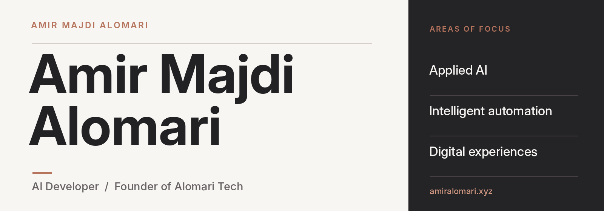

<picture>
  <source media="(prefers-color-scheme: dark)" srcset="assets/readme-header-dark.png">
  
</picture>

 
 

&nbsp;
&nbsp;
&nbsp;

 

## About

I'm an AI developer and the founder of **Alomari Tech**, interested in how applied AI, automation, and thoughtful digital design can make technology more useful. This repository contains the source for my personal portfolio at **[amiralomari.xyz](https://amiralomari.xyz/)**.

## What I work on

<table>
  <tr>
    <td width="33%" valign="top">
      <strong>Applied AI</strong>
      
Conversational interfaces and practical tools for working with information.

    </td>
    <td width="34%" valign="top">
      <strong>Intelligent automation</strong>
      
Connected workflows that bring tools, data, and decisions together.

    </td>
    <td width="33%" valign="top">
      <strong>Digital experiences</strong>
      
Responsive interfaces designed with usability and interaction in mind.

    </td>
  </tr>
</table>

## Explore

| | |
| :-- | :-- |
| **[Portfolio](https://amiralomari.xyz/)** | Interactive work examples and my background |
| **[Amir AI](https://amiralomarii.github.io/amirai/)** | An assistant for exploring my work |
| **[News](https://amiralomari.xyz/news/)** | Articles and commentary on technology |
| **[Alomari Tech](https://alomaritech.xyz/)** | My company |

 

**Have something in mind?**

[Email me](mailto:amirooxstar@gmail.com) &nbsp;&nbsp;·&nbsp;&nbsp; [Connect on LinkedIn](https://www.linkedin.com/in/amir-majdi-alomari/)

 

© 2026 Amir Majdi Alomari. All rights reserved.

